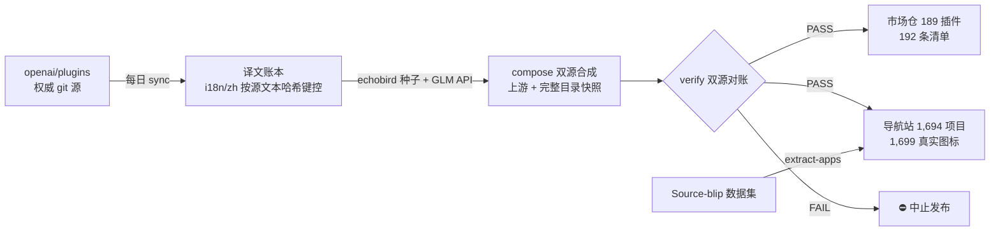

<div align="center">
  
</div>

# codex-plugins-zh

**把 OpenAI 官方目录全量变成中文的。**
- **插件市场（可装进 Codex）**：**189 个官方插件全部汉化**——上游 [openai/plugins](https://github.com/openai/plugins)（62，权威实时）∪ 完整 curated 目录快照（+127，含 ChatGPT 账号专属的远程目录插件）；
- **应用与连接器导航**：**1,505 个 ChatGPT 应用/连接器**中文条目（复用 [Source-blip 中文导航](https://github.com/Source-blip/codex-plugin-chinese-navigation) 2026-07 数据集与 1,699 个官方图标，MIT）；
- 合计 **1,694 个项目**，186 个真实官方图标，无损校验 **6,720 个文件 0 分歧**，每日自动跟进上游。

适配场景：Codex 接第三方 API / 中转站、不走 OpenAI 官方认证链路、onboarding 没给你配市场——或者你只是想用中文看懂每个插件/应用是干什么的。

<div align="center">
  
</div>

## 三步用上

1. Codex 里打开 **设置 → 插件 → 添加市场**
2. 粘贴：
   ```text
   https://github.com/kael-odin/codex-plugins-zh.git
   ```
3. 重开会话 → 插件列表出现「**Codex 官方插件 · 中文版**」（192 条清单 / 189 个可装插件，含 API 版清单 `openai-api-curated-zh`）

命令行等价：

```bash
codex plugin marketplace add https://github.com/kael-odin/codex-plugins-zh.git
# 想要英文原味官方市场（上游 git 上的 65 条）：
codex plugin marketplace add https://github.com/openai/plugins.git
# 以后更新快照：
codex plugin marketplace upgrade
```

> API-key 登录的用户：App 自带的「Built by OpenAI · 50 个插件」（`openai-api-curated`）**请保留**，它和中文市场并存互不影响。撞名、死条目清理、占位路径等坑全部写在 **[docs/setup-guide.md](docs/setup-guide.md)**。

## 数据从哪来（三个源，各司其职）

| 数据源 | 数量 | 角色 | 新鲜度 |
| --- | --- | --- | --- |
| [openai/plugins](https://github.com/openai/plugins)（git） | 62 插件 / 65 清单条目 | **权威源**，逐字节无损对账，每日 CI 跟进 | 实时 |
| 完整 curated 目录快照（[echobird/codex-plugins](https://cnb.cool/echobird/codex-plugins)） | +127 插件（合计 192 条目） | 官方**远程 curated 目录**（仅 ChatGPT 账号认证可拉，`api key auth is not supported`）的社区快照 | 2026-09-19 |
| [Source-blip 中文导航](https://github.com/Source-blip/codex-plugin-chinese-navigation) 数据集（MIT） | 1,505 应用/连接器 + 1,699 图标 + 中文别名 | 站点「应用与连接器」分区，`tools/extract-apps.mjs` 整包抽取 | 2026-07-15 |

每一份都在站点上标注来源与快照日期，绝不冒充实时。上游若在 git 上发布新插件，次日自动进中文市场；快照区何时刷新取决于上游社区仓库。

## 「无损」是可以被机器证明的

`tools/verify.mjs` 双源对账，CI 门禁：

| 检查项 | 结果 |
| --- | --- |
| 上游部分（技能正文、脚本、MCP 配置……） | 5,340 个文件**逐字节一致** |
| 快照部分（127 个额外插件） | 1,316 个文件对快照源**逐字节一致** |
| 清单 | 65 条上游条目原样保留 + 142 条快照条目原样保留 |
| 白名单（仅 `interface.*` 展示字段 + 市场名） | 分歧数 **0**，有任何分歧 CI 拒绝发布 |

品牌名保留英文；SKILL.md 一律不动；中文市场注册名 `openai-curated-zh`，永不占用官方 ID——**出任何问题，官方市场原样可用**。

## 管线



- **译文不会张冠李戴**：每条译文以「源文本哈希」为键（[i18n/zh/](i18n/zh)），上游改词自动失效重翻。
- **搜索不迷路**：中文别名表（英伟达→NVIDIA、做表格→Sheets 类应用……）整包复用自 Source-blip 的 keywords 数据。
- **导航站**：原生 HTML/JS 无框架；插件/应用双模式、26 个中文分类、亮暗主题、中英界面切换。

## 本地开发（零依赖，Node ≥ 20）

```bash
node tools/sync.mjs                        # 拉上游 + diff
node tools/translate.mjs --seed .seed      # 可选：采纳种子译文
GLM_API_KEY=… node tools/translate.mjs --execute   # 可选：API 补翻
node tools/compose.mjs                     # 双源合成发布树 + catalog
node tools/verify.mjs                      # 双源无损对账（必须 PASS）
node tools/build-site.mjs                  # 打包 dist/（站点+应用数据+1,699 图标）
node tools/extract-apps.mjs <source-blip 的 index.html>   # 快照更新时重跑
```

`.seed`（echobird 快照克隆）与 `.refs/source-blip-nav` 需就位；CI 每日自动克隆 `.seed`。

## 姊妹项目

**[claude-plugins-zh](https://github.com/kael-odin/claude-plugins-zh)** — Claude Code 官方插件中文市场：anthropics/claude-plugins-official（315 个插件，Apache-2.0）全量汉化，`/plugin marketplace add kael-odin/claude-plugins-zh` 即用。同一套管线，同一套无损承诺。

## 常见问题

- **为什么 git 上只有 62 个，你却有 189 个？** OpenAI 的完整 curated 目录（~194）只通过 App 的远程市场下发且仅限 ChatGPT 账号认证；git 仓库只承载其中一部分。我们用社区完整快照补齐并明确标注快照日期。
- **API 用户该用哪个？** App 自管的 `openai-api-curated`（50 个）继续用；中文市场仓内含对应 API 版清单。
- **为什么 SKILL.md 不翻？** 技能正文是模型指令，翻译引入语义漂移；触发短语保留英文保证触发质量。

## Roadmap 与合规

[docs/ROADMAP.md](docs/ROADMAP.md) · 本仓库代码 MIT（[LICENSE](LICENSE)）；`plugins/` 逐字转载自 openai/plugins 及社区快照（无 LICENSE，权利归各自权利人）；应用目录数据与图标来自 Source-blip（MIT 代码/数据，商标归权利人）——详见 [NOTICE.md](NOTICE.md)。
