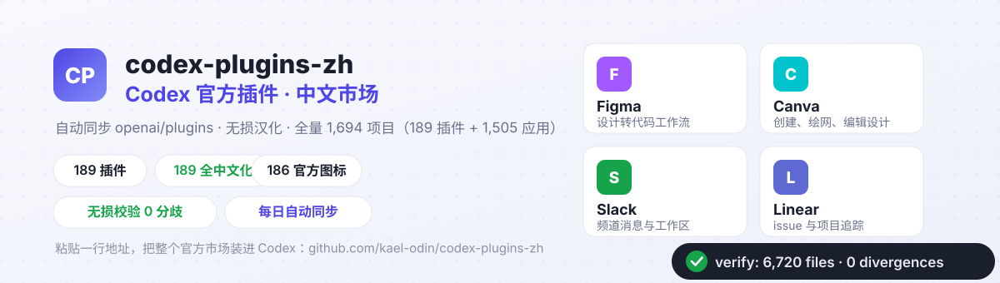
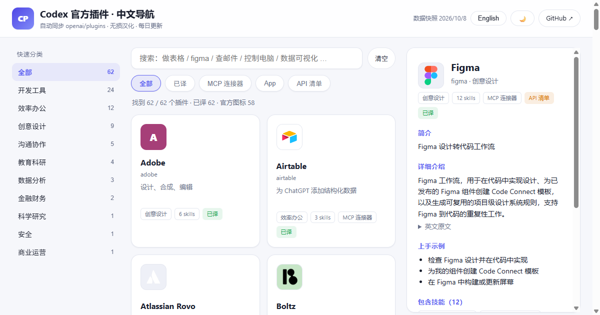
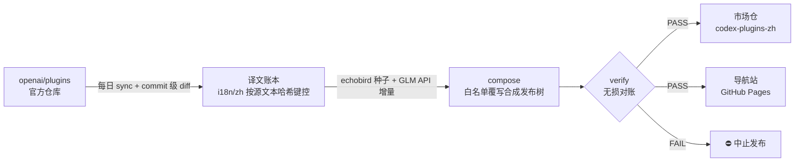

<div align="center">
  
</div>

# codex-plugins-zh

**把 OpenAI 官方插件市场变成中文的。**
自动同步 [openai/plugins](https://github.com/openai/plugins)（OpenAI 官方插件仓库），对插件门面做**无损汉化**（机器可证），每日跟进上游，并附带一个带真实图标、支持中英切换的[可视化中文导航站](https://kael-odin.github.io/codex-plugins-zh/)。

适配场景：Codex 接第三方 API / 中转站、不走 OpenAI 官方认证链路、onboarding 没给你配官方市场——或者你只是想用中文看懂每个插件是干什么的。

<div align="center">
  
</div>

## 三步用上

1. Codex 里打开 **设置 → 插件 → 添加市场**
2. 粘贴：
   ```text
   https://github.com/kael-odin/codex-plugins-zh.git
   ```
3. 重开会话 → 插件列表出现「**Codex 官方插件 · 中文版**」

命令行等价：

```bash
codex plugin marketplace add https://github.com/kael-odin/codex-plugins-zh.git
# 想要英文原味官方市场（65 个）：
codex plugin marketplace add https://github.com/openai/plugins.git
# 以后更新快照：
codex plugin marketplace upgrade
```

> API-key 登录的用户：App 自带的「Built by OpenAI · 50 个插件」（`openai-api-curated`）**请保留**，它和中文市场并存互不影响。撞名、死条目清理、占位路径等坑全部写在 **[docs/setup-guide.md](docs/setup-guide.md)**。

## 「无损」是可以被机器证明的

翻译只发生在「你看得见的门面」（卡片简介、详细介绍、上手示例），每次发布前 `tools/verify.mjs` 把发布树与上游逐文件对账：

| 检查项 | 结果 |
| --- | --- |
| 非白名单文件（技能正文、脚本、MCP 配置……） | 5,338 个文件**逐字节一致** |
| 白名单文件（市场清单 `name`/`interface`、`plugin.json` 的 `interface.*`） | 66 个，白名单外字段**零改动** |
| 分歧 | **0**（有任何分歧 CI 直接拒绝发布） |

品牌名保留英文；SKILL.md 一律不动（那是给模型读的指令，翻译它等于给行为埋雷）；中文市场注册名 `openai-curated-zh`，永不占用官方 ID——**出任何问题，官方市场原样可用**。

## 管线：一条流水线，三个出口



- **译文不会张冠李戴**：每条译文以「源文本哈希」为键（[i18n/zh/](i18n/zh)）。上游改一个词，哈希变化，旧译文自动失效重翻。
- **译文来源**：[echobird/codex-plugins](https://cnb.cool/echobird/codex-plugins) 种子快照（标记 `verified: false`）+ GLM API 批量翻译（`verified: true`，仓库 Secrets 配 `GLM_API_KEY` 后 CI 自动补缺）。
- **导航站**：原生 HTML/JS 无框架，真实官方图标、中文日常说法搜索（试试「做表格」「控制电脑」）、分类侧栏、快捷筛选、亮/暗主题、中/英界面一键切换。

## 本地开发（零依赖，Node ≥ 20）

```bash
node tools/sync.mjs                        # 拉上游 + diff
node tools/translate.mjs --seed <克隆目录>  # 可选：采纳种子译文
GLM_API_KEY=… node tools/translate.mjs --execute  # 可选：API 补翻
node tools/compose.mjs                     # 合成发布树 + catalog
node tools/verify.mjs                      # 无损对账（必须 PASS）
node tools/build-site.mjs                  # 打包 dist/ 预览站点
```

## 常见问题

- **和官方市场什么关系？** 并存的独立市场，只换门面不改行为；本仓库失效时官方市场照常工作。
- **API 用户该用哪个？** App 自管的 `openai-api-curated`（50 个，含 superpowers 等 CODEX 专属）继续用；中文市场仓内含对应 API 版清单 `openai-api-curated-zh`。
- **为什么 SKILL.md 不翻？** 技能正文是模型指令，翻译引入语义漂移且维护成本爆炸；触发短语保留英文原文保证触发质量。译文已入库，灰度验证后可启用。

## Roadmap 与边界

见 [docs/ROADMAP.md](docs/ROADMAP.md)：cnb.cool 国内镜像、SKILL.md 描述汉化灰度、「本次更新」页等。上游清单自带 3 条死引用（crowdstrike-falcon-*、qodo），catalog 已标 `missing`。

## 合规

本仓库代码 MIT（[LICENSE](LICENSE)）；`plugins/` 内容逐字转载自 openai/plugins（该仓库暂无 LICENSE），权利归属与下架通道见 [NOTICE.md](NOTICE.md)。
